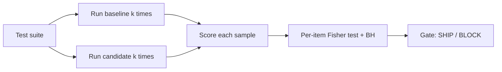

# FlipCheck

**Regression testing for LLM apps: find what broke, separate real regressions from noise, and get a ship or block verdict.**

[](https://github.com/kinzamalik18/flipcheck/actions/workflows/ci.yml)
[](https://www.python.org/downloads/)
[](LICENSE)

> **Report screenshot placeholder.** A screenshot of the HTML report will be added here after the first real deployment run.

---

## The problem

Aggregate accuracy is a misleading signal. A new model version can raise the overall pass rate while silently breaking a different set of cases. Yan et al. (CVPR 2021) named this pattern the Negative Flip Rate (NFR) and showed it occurs even when retraining the same architecture. Echterhoff et al. (MUSCLE, 2024) confirmed the same pattern in LLM updates: even with identical downstream fine-tuning, switching the base model from Llama 1 to Llama 2 caused negative flips that their compatibility training reduced by up to 40%.

---

## Why single runs lie

A single greedy sample per item cannot separate real regressions from random noise. Cacioli (2026) measured the cost directly: greedy single-shot evaluation missed 42% of reliably changed items and falsely flagged 25% of unchanged items as changed. On the prompt side, Ma, Yang and Kastner (CAIN 2024) found that after an API update, a different prompt became best by 8.7% accuracy, meaning the rankings you measured before the update no longer hold.

---

## What FlipCheck does differently

- **Repeated sampling.** Each test item runs k times per version. One sample per item is not enough to tell signal from noise.
- **Per-item reliable change.** Fisher exact test plus Benjamini-Hochberg correction separates real regressions and improvements from noise at each item. Flaky items never fail a build on their own.
- **Adaptive sampling.** Extra samples go only to uncertain items, keeping API costs low while concentrating power where it is needed.
- **Slice reports.** Results break down by tags (for example "urdu" or "emergency"). Critical cases are gated more strictly.
- **A clear verdict.** Every run ends in SHIP, SHIP_WITH_CAVEATS, or BLOCK, with the specific cases and reasons behind it.
- **CI gate.** One command, one exit code. Exit 1 on BLOCK, 0 on SHIP.
- **Zero-cost local setup.** Works with Ollama (local models), free API tiers (Gemini, Groq), and a mock target that needs no keys at all. Storage is SQLite.

---

## Results

Measured on synthetic suites of 200 items over 50 random seeds. Ground truth: 10% of items truly regress (baseline pass probability 0.9, candidate 0.3), 10% truly improve (0.3 to 0.9), 20% are flaky on both sides (0.5 each), 60% are stable (0.9 each). Significance level alpha=0.05.

### Table 1: Detection of reliable regressions

| Mode | Settings | Precision | Recall | FAR (stable) | FAR (flaky) | Avg calls |
|---|---|---|---|---|---|---|
| Single shot | k=1 | 0.000 (sd 0.000) | 0.000 (sd 0.000) | 0.000 (sd 0.000) | 0.000 (sd 0.000) | 400 (sd 0) |
| Fixed | k=5 | 0.000 (sd 0.000) | 0.000 (sd 0.000) | 0.000 (sd 0.000) | 0.000 (sd 0.000) | 2000 (sd 0) |
| Adaptive | k_min=2, k_max=8, step=2, budget=2000 | 0.620 (sd 0.490) | 0.103 (sd 0.119) | 0.000 (sd 0.000) | 0.000 (sd 0.000) | 1999 (sd 5) |

Columns show mean (sd) over 50 seeds. Precision: reliable regressions predicted correctly divided by total predicted. Recall: true regressions correctly predicted divided by total true regressions. FAR: false alarm rate on that item class.

### Table 2: Single-shot negative flip rate

NFR measures the fraction of items where the baseline passed on sample 0 but the candidate failed, without any statistical test applied.

| Mode | Settings | NFR (unconditional) | NFR (conditional on base pass) |
|---|---|---|---|
| Single shot | k=1 | 0.177 (sd 0.023) | 0.233 (sd 0.030) |
| Fixed | k=5 | 0.177 (sd 0.023) | 0.233 (sd 0.030) |
| Adaptive | k_min=2, k_max=8, step=2, budget=2000 | 0.177 (sd 0.023) | 0.233 (sd 0.030) |

NFR uses sample 0 only, regardless of k.

**Note on the BH floor.** With 200 items and k=5 samples per side, the smallest achievable Fisher exact p-value is approximately 0.004. Benjamini-Hochberg adjustment requires the rank-1 p-value to be below alpha/n = 0.05/200 = 0.00025, which is 16 times smaller than that floor. This means fixed k=5 cannot detect any regression in a 200-item suite at alpha=0.05, regardless of the true effect size. This is a known statistical limit documented in SPEC section 9.1, not a bug. With k_max=8 (adaptive mode), the minimum p drops to about 0.000078, just below the BH threshold. For suites with fewer than about 50 items, or when k_max is raised above 10, detection rates improve substantially.

**Dogfooding results will be added after a real deployment run.**

---

## Quickstart

The package is not yet published on PyPI. Use the git clone path:

```bash
# Clone and install
git clone https://github.com/kinzamalik18/flipcheck
cd flipcheck
uv sync

# Initialize a sample project (creates flipcheck.yaml and suites/example.jsonl)
uv run flipcheck init

# Run a comparison using the mock target (no API keys needed)
uv run flipcheck run

# Generate the HTML report
uv run flipcheck report --out report.html

# Or do all three in one step for CI
uv run flipcheck ci
```

When `pip install flipcheck-llm` is available (after PyPI release), that will replace the clone step.

### Real run with Ollama

```bash
# Pull a small model
ollama pull llama3.2:3b

# Edit flipcheck.yaml to point targets at your Ollama model and prompts
uv run flipcheck run
```

---

## CI setup

Add this workflow to `.github/workflows/flipcheck.yml` in your project:

```yaml
name: FlipCheck

on:
  pull_request:
    branches: [main]

jobs:
  flipcheck:
    runs-on: ubuntu-latest
    steps:
      - uses: actions/checkout@v4

      - name: Install uv
        uses: astral-sh/setup-uv@v4
        with:
          version: "latest"

      - name: Set up Python
        run: uv python install 3.11

      - name: Install FlipCheck
        run: uv sync

      - name: Initialize FlipCheck config
        run: uv run flipcheck init

      - name: Run FlipCheck comparison
        run: uv run flipcheck ci
        # The mock target requires no API keys.
        # To use a real model, add your API key as a repository secret:
        #   For Gemini: add GEMINI_API_KEY to repository secrets
        # env:
        #   GEMINI_API_KEY: ${{ secrets.GEMINI_API_KEY }}

      - name: Upload FlipCheck report
        uses: actions/upload-artifact@v4
        if: always()
        with:
          name: flipcheck-report
          path: reports/
```

Exit code 1 on BLOCK, 0 on SHIP. Add `--strict` to also exit 1 on SHIP_WITH_CAVEATS.

---

## Configuration reference

`flipcheck.yaml` in your project root. See `docs/SPEC.md` section 4 for the full reference.

```yaml
project: my-llm-app
suite: suites/main.jsonl
default_scorers:
  - type: exact
targets:
  baseline:
    type: llm
    model: ollama/llama3.2:3b
    prompt: prompts/v1.j2
    params: {temperature: 0.7, max_tokens: 300}
  candidate:
    type: llm
    model: ollama/llama3.2:3b
    prompt: prompts/v2.j2
    params: {temperature: 0.7, max_tokens: 300}
judge:
  model: gemini/gemini-2.5-flash
  params: {temperature: 0}
sampling:
  mode: adaptive       # fixed or adaptive
  k_min: 2
  k_max: 8
  step: 2
  budget_calls: 1500   # hard cap on model calls, judge included
gates:
  alpha: 0.05
  max_reliable_nfr: 0.03
  block_on_critical_regression: true
  max_flaky_rate: 0.15
  max_inconclusive_rate: 0.10
  max_slice_drop: 0.10
cache_path: .flipcheck/flipcheck.sqlite
```

API keys come from environment variables or a `.env` file only. Never put them in `flipcheck.yaml`.

---

## How it works



Each item in the test suite gets k samples from the baseline and k samples from the candidate. Each sample is scored (exact match, regex, JSON field, LLM judge, or a custom function). Per-item pass counts feed a one-sided Fisher exact test. Benjamini-Hochberg correction controls false discoveries across all items. The gate checks the reliable regression rate, critical-case regressions, and slice-level drops to produce the final verdict.

---

## Research references

- Yan et al., 2021, *Positive-Congruent Training: Towards Regression-Free Model Updates* ([arXiv 2011.09161](https://arxiv.org/abs/2011.09161)), CVPR 2021. Named the Negative Flip Rate (NFR) and showed regressions occur even when retraining the same architecture.

- Xie et al., 2021, *Regression Bugs Are In Your Model! Measuring, Reducing and Analyzing Regressions in NLP Model Updates*, ACL 2021. Brought negative flip analysis to NLP model updates.

- Echterhoff et al., 2024, *MUSCLE: A Model Update Strategy for Compatible LLM Evolution* ([arXiv 2407.09435](https://arxiv.org/abs/2407.09435)). Showed negative flips occur when an LLM base model is updated, even with identical downstream training. Their compatibility training reduced negative flips by up to 40% from Llama 1 to Llama 2.

- Ma, Yang and Kastner, 2024, *(Why) Is My Prompt Getting Worse? Rethinking Regression Testing for Evolving LLM APIs* ([arXiv 2311.11123](https://arxiv.org/abs/2311.11123)), CAIN 2024. Found that LLM APIs change silently and regression tests must track model and prompt versions together. After an API update, a different prompt became best by 8.7% accuracy.

- Cacioli, 2026, *Beyond the Mean: Within-Model Reliable Change Detection for LLM Evaluation* ([arXiv 2604.27405](https://arxiv.org/abs/2604.27405)). Adapted the Reliable Change Index to item-level LLM version comparison using repeated sampling. Greedy single-shot evaluation missed 42% of reliably changed items and falsely flagged 25% of unchanged items.

- *CASPER: Change-Aware Slice Prioritization for Efficient Regression Testing of LLM-based Systems* ([arXiv 2608.00378](https://arxiv.org/abs/2608.00378)), 2026. Showed regression analysis works better at the level of test suite slices.

- *No Universal Signal Predicts Sample-Level LLM Regression under Version Updates* ([arXiv 2608.13607](https://arxiv.org/abs/2608.13607)), 2026. Found that which signals predict negative flips depends on the task.

- *Test Before You Deploy: Governing Updates in the LLM Supply Chain* ([arXiv 2604.27789](https://arxiv.org/abs/2604.27789)), 2026. Argues for deployer-side compatibility gates that block updates until regression testing passes.

---

## Roadmap

**V2:**
- Auto slices: embed inputs, cluster them, name clusters with an LLM, suggest tags
- Judge calibration: label 20 to 30 outputs, measure judge agreement, warn when it is low
- Triage loop in the report: accept a change, mark as a bug, update the expected answer
- Prompt diff view and cost/latency tradeoff in the verdict

**V3:**
- Agent trace diff: compare multi-step runs step by step and show the first divergence
- Drift watch: scheduled probe set against a live endpoint, alert on behavior change
- Regression risk score per item, using cross-version signals from the 2026 literature
- Hosted dashboard

---

## Contributing

1. Fork the repo and clone it locally.
2. Run `uv sync` to install all dependencies.
3. Run `uv run pytest -q` to check that the test suite passes before you start.
4. Make your change, add tests, and make sure `uv run ruff check .` is clean.
5. Open a pull request. The CI workflow runs tests, lint, and the em/en dash check automatically.

Please follow the writing style in `CLAUDE.md`: no em dashes or en dashes, no hype words, and every number either measured by this project or quoted from a cited paper.

---

## License

MIT. See [LICENSE](LICENSE).
